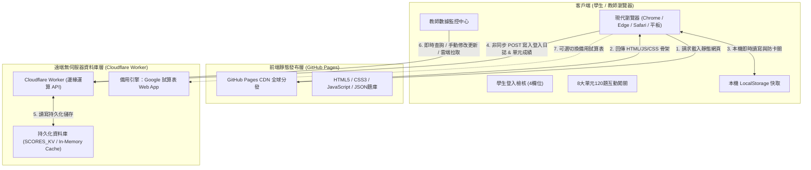
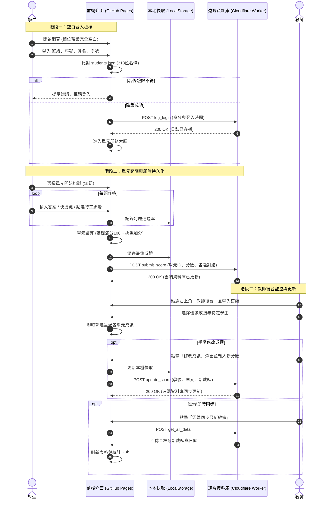

# CyberCloud 雲端神偷特工隊 - 系統全域架構、運作流程與維護維運手冊
> **專案版本**：v3.9.0  
> **適用對象**：系統架構師、教師管理員、後續維護工程師  
> **更新日期**：2026-11-04  

---

## 目錄
1. [系統全域架構圖 (System Architecture)](#一-系統全域架構圖)
2. [前後端解耦運作機制 (How It Works without GitHub DB)](#二-前後端解耦運作機制)
3. [端到端業務運作流程 (Data Lifecycle & Flow)](#三-端到端業務運作流程)
4. [託管方案選型與對比 (GitHub Pages vs. Cloudflare Pages)](#四-託管方案選型與對比)
5. [資料庫 Schema 與 API 規格](#五-資料庫-schema-與-api-規格)
6. [日常維運與排錯 SOP (Operations & Troubleshooting)](#六-日常維運與排錯-sop)

---

## 一、 系統全域架構圖

本系統採用現代化 **Jamstack 前後端分離（Decoupled Microservices）** 架構，由三大核心層次組成：



---

## 二、 前後端解耦運作機制

### ❓ 核心疑問：GitHub Pages 本身無雲端資料庫服務，系統是如何運作的？
1. **GitHub Pages 的角色定性**：
   - GitHub Pages 是一個純粹的 **靜態網站代管伺服器（Static Web Hosting）**。
   - 它不提供 Node.js、PHP、Python 後端執行環境，也不自帶 MySQL、PostgreSQL 或 MongoDB 資料庫。
   - 它唯一的任務是：當瀏覽器造訪 `https://lohastaiwan.github.io/cloud-search-quest/` 時，以超高速度將 `index.html`、`style.css`、`app.js` 與 `data.js` 送達使用者電腦。

2. **雲端資料庫由誰提供？**：
   - 資料庫功能由 **Cloudflare Worker** 獨立承擔。
   - 伺服器端部署於 Cloudflare 的全球邊緣運算網絡（Edge Network），端點網址為：
     `https://cybercloud-backend.coral-desk.workers.dev`
   - Worker 具備完整的 REST API 介面與持久化儲存機制，專門負責接收紀錄、檢索查詢與更新分數。

3. **前後端如何安全對話？（跨網域資源共享 CORS）**：
   - 當學生在 GitHub Pages 網址上做題時，前端的 `app.js` 會使用瀏覽器原生非同步通訊 `fetch()`，向 Cloudflare Worker 發送資料封包。
   - Cloudflare Worker 在回應中附帶了標準的 HTTP 標頭：
     ```http
     Access-Control-Allow-Origin: *
     Access-Control-Allow-Methods: GET, POST, OPTIONS
     Access-Control-Allow-Headers: Content-Type, Authorization
     ```
   - 瀏覽器檢驗此標頭後，確認允許跨站資料交換，從而打破了網域隔離，實現「在 GitHub Pages 玩遊戲，資料即時存入 Cloudflare 雲端資料庫」的無縫體驗。

---

## 三、 端到端業務運作流程



---

## 四、 託管方案選型與對比

### ❓ 核心疑問：為何不直接全站全部部署到 Cloudflare 上？

在 Web 系統工程架構中，主要有兩種落地策略：

| 評估維度 | 當前方案：GitHub Pages (前台) + Cloudflare (後端) | 方案 B：Cloudflare Pages + Worker (全站合一) |
| :--- | :--- | :--- |
| **部署複雜度** | **極低且直觀**：只需執行 `git push origin main`，完全免 CLI 互動認證 | 需設定 Cloudflare Pages CI/CD 綁定或使用 API Token |
| **版本溯源管理** | **極致透明**：所有 HTML/JS/題庫更動均有 Git Commit、PR 與 Issue 完整歷史 | 部署日誌需登入 Cloudflare Dashboard 查閱 |
| **網路存取穩定性** | 依託微軟 GitHub 全球 CDN，對學校區域網路與教育學術網極度友善 | 依託 Cloudflare Anycast CDN，具備優異的抗 DDoS 與邊緣計算能力 |
| **同源政策 (CORS)** | 前後端不同網域，需配置 CORS 標頭（系統已內建完成） | 同網域（`/api/*` 路由），原生同源 |
| **帳號存續性** | GitHub 帳號永久免費託管靜態頁面，永不過期 | 若使用 Temporary 預覽帳號受限於時限，需綁定正式帳號 |

> **📌 結論與演進建議**：
> 1. **現行架構最穩健**：前端利用 GitHub 進行版本控管與教學開源展示，後端利用 Cloudflare Worker 進行無伺服器計算，是現代開源軟體與教育專案最普遍的黃金組合。
> 2. **一鍵平滑遷移 Cloudflare Pages**：若學校政策要求全站同一網域，只要在 Cloudflare 控制台新增 Pages 專案並直接連結當前的 GitHub 儲存庫（`LOHASTAIWAN/cloud-search-quest`），每次 GitHub push 都會自動在 Cloudflare Pages 同步生成正式網址（如 `https://cybercloud-quest.pages.dev`），完全不需修改任何前端業務代碼！

---

## 五、 資料庫 Schema 與 API 規格

### 1. 遠端資料庫端點
- **生產環境網址**：`https://cybercloud-backend.coral-desk.workers.dev`

### 2. 核心資料模型 (Data Models)
```typescript
// 學生基本資料與成績
interface StudentRecord {
  studentId: string;    // 正式學號 (唯一鍵)
  name: string;         // 姓名
  class: string;        // 班級 (七年一班 ~ 七年十一班)
  seat: number;         // 座號
  unitScores: {         // 8大單元成績
    [unitId: string]: number; // 分數 (0 ~ 125)
  };
  lastUpdated: number;  // 最後更新時間戳記
}

// 登入歷程日誌
interface LoginLogEntry {
  class: string;
  seat: number;
  name: string;
  studentId: string;
  loginTime: string;    // "2026-11-04 12:50:00"
  timestamp: number;
  ip: string;
}

// 120 題每題通過率統計
interface QuestionStatEntry {
  attempts: number;     // 累計作答人次
  correct: number;      // 答對人次
  passRate: string;     // "85%"
}
```

### 3. API 呼叫格式
- **請求標頭**：`Content-Type: application/json`
- **主要 Actions**：
  1. `log_login`：記錄學生登入日誌。
  2. `submit_score`：提交單元測驗成果與答對率。
  3. `update_score`：教師手動修正特定學生分數。
  4. `get_all_data`：拉取全體學生最新成績名冊。
  5. `clear_database`：管理員清空重置資料庫（需密碼 `teacher115`）。

---

## 六、 日常維運與排錯 SOP

### 1. 學生反應「換電腦後成績消失了」？
- **原因**：本地端 LocalStorage 只保存在原電腦。
- **處理方式**：
  請學生或教師打開「教師後台」，點擊頂部 **「🔄 雲端同步最新數據」** 按鈕，系統會立即向遠端 Cloudflare 資料庫拉取最新紀錄，成績即可跨裝置瞬間還原。

### 2. 電腦教室網路斷線無法連線雲端？
- **應急方案（JSON 隨身碟合併法）**：
  1. 在個別學生的電腦上進入教師後台，點擊 **「📤 備份資料庫 (JSON)」** 下載存檔。
  2. 將檔案複製至隨身碟，帶至教師講桌電腦。
  3. 在講桌電腦點擊 **「📥 匯入合併 (JSON)」** 上傳，系統會自動智慧無損合併全班成績。

### 3. 如何更換為教師個人的 Cloudflare 帳號？
1. 本機終端執行 `npx wrangler login`，於瀏覽器登入教師個人的 Cloudflare 帳戶。
2. 執行 `npx wrangler deploy`，終端會輸出專屬的 Worker 網址。
3. 進入網頁教師後台，在「遠端雲端資料庫設定」中將新網址填入並按「儲存設定」即可完成遷移。

---
*文件維護：CyberCloud 核心開發團隊*
